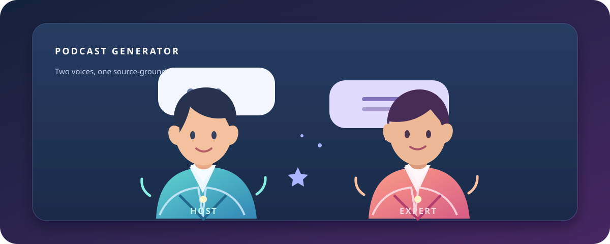

# Telegram Podcast Guide

This guide covers setting up and using the Telegram bot. It is written for the
current webhook workflow and settings page.



*Illustrative artwork: Host and Expert are sample characters, not screenshots
of the Telegram interface.*

## Before you start

You need:

- A Telegram account and a private chat with your bot.
- A deployed HTTPS endpoint for the FastAPI app, or a temporary HTTPS tunnel
  for local development.
- A Telegram bot token from [BotFather](https://t.me/BotFather).
- Your own API key for the script-generation provider you select (Groq,
  Gemini, or OpenAI).
- A Google Gemini API key for voice generation. Telegram always uses Google
  Gemini TTS; no other voice provider is available in Telegram.

If Gemini is selected for script generation, the same Gemini API key can be
used for both script generation and voice generation. If you select Groq or
OpenAI for the script, you need a separate Gemini key for voices.

## Deploy and connect the bot

### Option A: Render

1. Create a Render Blueprint from this repository and deploy the web service
   defined in `render.yaml`.
2. In the Render service's environment settings, add:
   - `TELEGRAM_BOT_TOKEN` — the token from BotFather.
   - `TELEGRAM_WEBHOOK_SECRET` — a private 1-256 character value containing
     only letters, numbers, `_`, or `-`.
   - `TELEGRAM_WEBHOOK_URL` — the full URL ending with
     `/telegram/webhook`, for example
     `https://your-service.onrender.com/telegram/webhook`.
3. Save the settings and wait for the service health check to pass at
   `/health`.
4. Put the same three values in your local `.env` file and register the
   webhook:

   ```powershell
   python -m podcast_generator.telegram.set_webhook
   ```

   This calls Telegram's Bot API to set the webhook and install the command
   menu. Run it again after changing the webhook URL or bot menu.
5. In Telegram, open the bot's private chat and send `/start`.

The app must be publicly reachable over HTTPS for Telegram to deliver webhook
updates. Keep the Render service configured with one worker; Telegram sessions
and active jobs are held in process memory. Render's free service can sleep,
and its filesystem is ephemeral, so jobs and local usage totals may be lost
after a restart or redeploy.

### Option B: local development with a tunnel

1. Install the project, create `.env` from `.env.example`, and ensure FFmpeg is
   installed and available on `PATH`:

   ```powershell
   python -m pip install -e .
   Copy-Item .env.example .env
   ```

2. In another terminal, expose port 8000 using an HTTPS tunnel, for example:

   ```powershell
   ngrok http 8000
   ```

3. Add your BotFather token and a webhook secret to `.env`. Replace the
example `TELEGRAM_WEBHOOK_URL` with the tunnel's HTTPS URL followed by
   `/telegram/webhook`.
4. Start the API locally:

   ```powershell
   uvicorn podcast_generator.api.main:app --host 0.0.0.0 --port 8000
   ```
5. Run `python -m podcast_generator.telegram.set_webhook`.
6. Start a private chat with the bot and send `/start`.

The tunnel URL may change when it restarts. Update `.env` and register the
webhook again if that happens. Keep the local API and tunnel running while
testing.

## Create a podcast

### From `/start`

1. Send `/start`.
2. Choose **PDF to Podcast** or **Script to Podcast**.
3. For a PDF, choose a learning goal (general, exam preparation, research
   explanation, interview preparation, concept learning, or a custom
   instruction). For the script/text workflow, continue to the upload step.
4. Upload the requested PDF or TXT file as a document attachment, not as a
   photo.
5. Wait for the bot to finish checking the file. You can use the default
   preferences or customize the conversation style, speaker voice IDs, and
   extra instructions.
6. Choose **Use saved settings & generate** to open Telegram device settings,
   or choose **Configure in chat (fallback)**.
7. The bot generates and sends the Markdown script first, then generates and
   sends the MP3.

### Shortcuts

- `/pdf2podcast` starts the PDF workflow and asks for a learning goal.
- `/script2podcast` starts the TXT workflow.
- `/start` offers both workflows.

In the TXT workflow, the uploaded text is source material for the generated
two-speaker script; it is not treated as an audio file.

## Configure providers and keys

### Telegram device settings

The settings page lets you choose the script provider/model, enter the
provider's key, choose the Google Gemini TTS model, set optional speaker voice
IDs, and add conversation preferences.

On supported Telegram clients, API keys are saved in Telegram SecureStorage on
that device. SecureStorage is device-specific and does not sync to your other
devices. When you select **Use settings for current podcast**, the required
keys are sent to the bot over HTTPS for that job. The bot validates them and
keeps them in process memory only; it does not persist them on the server.

If the Telegram client does not support SecureStorage, the page can save
preferences but will not save keys. Use the in-chat fallback to supply keys.

### In-chat fallback

The fallback asks for your script provider, model, and API key. For Groq or
OpenAI, it then asks for the Gemini key required for Google Gemini TTS. For
Gemini script generation, the same key is reused. API key messages are deleted
automatically where Telegram permits. If the bot says deletion failed, delete
the message yourself immediately.

Use a private chat only. Do not send API keys in a group or channel.

## Bot commands

| Command | What it does |
| --- | --- |
| `/start` | Show the PDF and TXT workflows. |
| `/pdf2podcast` | Start a PDF podcast and choose a learning goal. |
| `/script2podcast` | Start the TXT source workflow. |
| `/devicesettings` or `/settings` | Open the device settings page when configured. |
| `/keys` | Show official provider API-key pages. |
| `/usage` | Show successful delivery totals for all users and for your account. |
| `/help` | Show a short setup reminder. |
| `/cancel` | Cancel the current session or request cancellation of active work. |

`/configure` is also recognized as an alias for opening the settings page.

## Upload limits and processing

Defaults can be changed through environment variables:

| Setting | Default | Meaning |
| --- | ---: | --- |
| `TELEGRAM_MAX_FILE_SIZE` | 20 MiB | Maximum downloaded PDF/TXT size. |
| `TELEGRAM_MAX_TEXT_CHARACTERS` | 200,000 | Maximum extracted or uploaded text length. |
| `TELEGRAM_MAX_AUDIO_SIZE` | 50 MiB | Maximum MP3 size sent through Telegram. |
| `TELEGRAM_SESSION_TTL_SECONDS` | 1,800 seconds | Idle-session lifetime. |
| `TELEGRAM_JOB_TIMEOUT_SECONDS` | 1,800 seconds | Time budget for script and voice generation. |

The bot extracts PDF text, creates a source-grounded dialogue, and uses Google
Gemini TTS to synthesize its two speakers. Long PDFs are split into sections
with continuity context. The script document is delivered before audio; the
local script copy is removed after Telegram accepts the document. Job
temporary files are cleaned up after delivery, failure, cancellation, or
session expiry.

## Troubleshooting

- **The bot does not respond:** Check that the API is healthy at `/health`, the
  webhook URL is HTTPS and ends in `/telegram/webhook`, and the bot token and
  webhook secret match the deployed environment. Re-run the webhook
  registration command after configuration changes.
- **The upload is rejected:** Send a PDF for the PDF workflow or a UTF-8 TXT
  file for the text workflow. Check the configured file-size and text-length
  limits.
- **Key validation fails:** Confirm the key is for the selected script
  provider. Google Gemini TTS always needs a valid Gemini key; if the script
  provider is also Gemini, one valid key can serve both.
- **The settings page will not start the job:** Confirm it was opened from
  Telegram and, if SecureStorage is unavailable, use **Configure in chat
  (fallback)**.
- **Generation is slow or times out:** Large documents require more script and
  TTS chunks. Check provider availability and the configured job timeout.
- **The bot sends the script but not audio:** The script step succeeded, but
  Gemini TTS or Telegram audio delivery failed. Check Gemini access, model
  configuration, network availability, and the audio-size limit, then retry.
- **Usage totals reset:** The current usage file is local to the service
  filesystem. On an ephemeral host it may be lost during a restart or
  redeploy.
